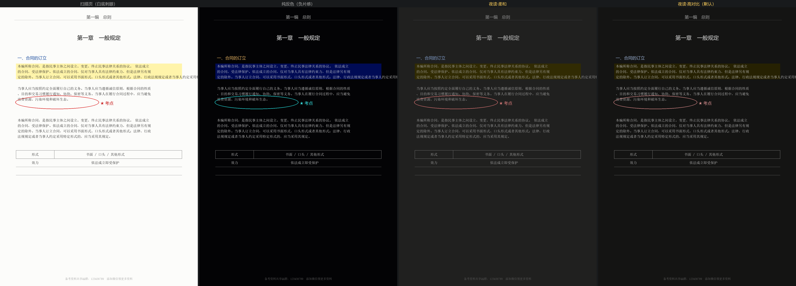

# PDF Toolkit — 扫描书实战工具集（加目录 / 去水印 / 解锁 / 夜读化）

对 **150+ 份 PDF**（扫描版为主）完成「加书签目录 / 去水印 / 解权限锁 / 夜读化」的完整实战沉淀。
全部基于 **PyMuPDF (fitz)** + **RapidOCR**，纯本地处理，零外部服务。

**不绑定任何特定书籍**：目录、书单、水印规则全部走 `config.json` / 命令行参数，
可直接用于任何个人 PDF 库。首个实战场景（150+ 本备考教材，12.6GB）的规范见 `docs/`。
README 与脚本中的示例均为合成样张，不含真实书籍内容。



> 实战结果：150 份无书签 → 150 份书签全量补齐（0 结构问题）；第三方水印清零；权限锁清零。

---

## ⚠️ 使用边界（先读这个）

本项目只针对**个人自用文档**的三类干扰：

| 会处理 | 不会处理 |
|---|---|
| 第三方导流/倒卖广告水印（QQ群、微信号、"低价购买"） | 出版社/机构的**正版署名**（自家书眉、封面logo） |
| 复制/打印权限锁 | 任何 DRM 加密 |
| 书签缺失/结构错乱 | — |

判定规则写死在脚本里：**水印 = 跨页重复文本 + 位于页眉页脚**。正文里出现"微信公众号"（如真题题干引用）绝不能 redact——实战中真题题干就踩过这个雷。

---

## 三条管线

### 1️⃣ 加书签目录（两路）

**A. 文本层规则引擎**（`add_toc_textlayer.py`）——有文字层的 PDF：
- 内置 5 种可复用的版式规则：真题试卷（页眉科目状态机 + 题型行时间线交错）、答案解析（题型行二次轮换切分上下册）、章节题集（章/节两层 + 去重）、多编循环（章号回退=新编开始）、页眉科目题集（覆盖率 <40% 自动跳过的质量闸门）
- 规则通过 `toc_plan.json`（`{"items": [{"file": "...", "rule": "shijuan"}]}`）指派给具体文件；仿照内置函数写正则状态机即可扩展新规则
- dry-run 默认，`--write` 才写盘；写入前快照旧 TOC 到 JSON（可回滚）

**B. 扫描件 OCR**（`detect_bigtitle_pages.py` → `add_toc_ocr_mulu.py`）——纯图片 PDF：
- 大字分隔页检测：dpi60 渲染 → 水平投影分行 → 行高 ≥1.55×中位数且 y<42% 记候选
- 印刷目录页解析：RapidOCR 全页识别 → `标题+页码` 正则抽取 → **页脚印刷页码↔PDF物理页 delta 校准** → 写书签
- 书签层级/页码规范见 [`docs/加目录标准-v2.md`](docs/加目录标准-v2.md)（基于 Project MUSE 出版规范本地化）

### 2️⃣ 去水印 + 解权限锁（三路，按水印类型选）

| 脚本 | 适用 | 手法 |
|---|---|---|
| `remove_wm_textlayer.py` | 文本层水印（回忆版真题） | 行级正则 → `add_redact_annot`(外扩±1px盖抗锯齿) → `apply_redactions(images=NONE, graphics=NONE, text=REMOVE)`，**只删字不动图**；带自校验（重开文件统计残留命中） |
| `remove_wm_batch.py` | 批量去水印/解锁 | 处理前 **MD5 备份原件 + 映射表 CSV**（可回滚），校验不过自动跳过；`--dewm` 删水印+解锁、`--unlock` 只解锁不动水印（正版署名按此处理） |
| `remove_wm_scan_cover.py` | 扫描件图像水印 | 固定区域（页脚 10%）像素覆盖；**先测区域非白密度，>40% 视为正文自动跳过**（防误伤正文密集页） |

所有去水印脚本统一 `save(encryption=PDF_ENCRYPT_NONE)`，抹字和解锁一步完成，页码正文无损。

### 3️⃣ 夜读化（`night_pdf_batch.py`）

扫描版 PDF 无文字层，阅读器夜间模式全部无效。本工具给整页图像做**保色相反亮度**：白纸→深灰底(#1e1e1e)、黑字→亮灰字、彩色标注保留色相只压暗。

- 用 `doc.update_stream(xref)` **原地改写图像对象**（不要用 `page.replace_image()`！它会新增对象留下旧图，文件双倍膨胀——实测踩坑）
- 灰度页自动转 DeviceGray 省体积；>2400px 的超大扫描图降采样（26MP 原图 q85 重编码会膨胀 2 倍，降采样后反比原书小 60%）
- 书签/页面布局/页码全保留；66 本 12.6GB 实测全通过

---

## 💊 踩坑清单（比代码更值钱的部分）

1. **水印误报是最大雷区**：正文词"购买/代理/微信公众号"会大量误报，必须「跨页重复 + 页眉页脚位置」双条件；扫描件水印**像素初筛 + 目视确认**两步走，条带相似度阈值法不可靠（某系列 25 本全部误报）。
2. **书签页码指向整页分隔页**，容差 1 页，≥2 页必须修；写入后全局页码必须单调不减。OCR 错字要人工对照表修正（如 `读职罪→渎职罪`、`第——编→第一编`），标题以**书面印刷字**为准。
3. **无结构锚点的书不要硬造目录**（回忆版真题直接跳过）；质量闸门（页眉覆盖率 <40% 跳过）比事后返工便宜。
4. **凡是改文件的操作**：dry-run 默认 + 旧状态快照 JSON + 原件 MD5 备份 + 映射表 CSV，四件套齐了才敢批量跑。
5. `apply_redactions` 是 **Page** 方法不是 Document 方法；`exec` 注入脚本要补 `__file__`。
6. `page.replace_image()` 新增对象不替换，孤儿旧图让体积翻倍；用 `update_stream + xref_set_key` 原地改写。
7. 权限锁判断用 `doc.permissions`，解锁后必须重开文件验证（`PDF_ENCRYPT_NONE` 只在 save 时生效）。

---

## 脚本清单

| 脚本 | 功能 | 依赖 |
|---|---|---|
| `audit_pdfs.py` | 全量盘点：页数/书签/文本层/权限/水印命中 | PyMuPDF |
| `add_toc_textlayer.py` | 文本层 PDF 批量加书签（5 种版式规则引擎 + toc_plan.json） | PyMuPDF |
| `detect_bigtitle_pages.py` | 扫描件大字分隔页检测（投影法） | PyMuPDF, numpy |
| `add_toc_ocr_mulu.py` | 印刷目录页 OCR 解析→书签 | PyMuPDF, RapidOCR |
| `remove_wm_textlayer.py` | 文本层水印 redact + 解锁 + 自校验 | PyMuPDF |
| `remove_wm_batch.py` | 批量去水印/解锁（MD5 备份原地替换，--dewm/--unlock 分组） | PyMuPDF |
| `remove_wm_scan_cover.py` | 扫描件固定区域覆盖（密度闸门） | PyMuPDF, numpy |
| `night_pdf_batch.py` | 扫描书夜读化（--root 自动发现，断点续传） | PyMuPDF, numpy, Pillow |
| `common.py` | 配置加载 / MD5 备份 / 路径解析 | — |
| `ocr_lib.py` | RapidOCR 封装（行级输出） | RapidOCR, pypdf |

## 依赖与用法

```bash
pip install pymupdf numpy pillow rapidocr-onnxruntime pypdf

# 1. 配置：复制 config.example.json 为 config.json，改 root 和水印关键词
cp scripts/config.example.json scripts/config.json

# 2. 盘点现状
python scripts/audit_pdfs.py --root D:/my-pdfs

# 3. 加目录（一律先 dry-run）
python scripts/add_toc_textlayer.py --plan scripts/toc_plan.example.json --root D:/my-pdfs
python scripts/add_toc_textlayer.py --plan my_plan.json --write          # 写盘（自动快照）
python scripts/detect_bigtitle_pages.py --root D:/my-pdfs                # 扫描件：先定位分隔页
python scripts/add_toc_ocr_mulu.py dry --pages scan_tocpages.json

# 4. 去水印 / 解锁
python scripts/remove_wm_textlayer.py 书1.pdf 书2.pdf --out clean_out
python scripts/remove_wm_batch.py --dewm 广告书.pdf --unlock 正版书.pdf  # MD5 备份 + 原地替换
python scripts/remove_wm_scan_cover.py 扫描书.pdf:left --write           # 页脚固定区域覆盖

# 5. 夜读化（已处理的自动跳过，可断点续传）
python scripts/night_pdf_batch.py --root D:/my-pdfs --limit 1            # 先试跑一本
python scripts/night_pdf_batch.py --root D:/my-pdfs                      # 全量
```

## Docs

- [`docs/加目录标准-v2.md`](docs/加目录标准-v2.md) — 书签层级/页码/标题完整规范（Project MUSE 出版规范本地化版）

## License

MIT
