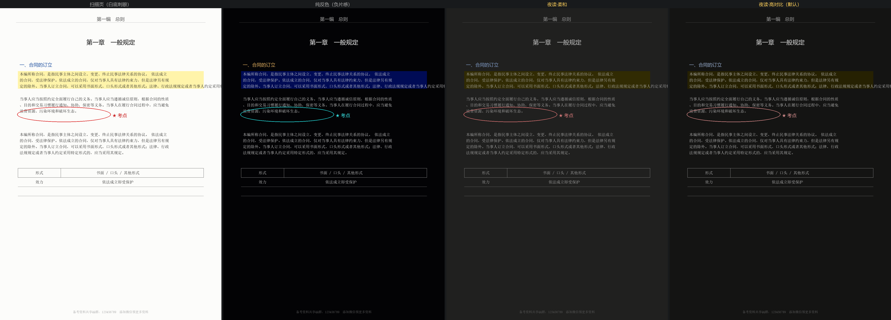

<div align="center">

# 📚 PDF Toolkit

**Batch toolkit for scanned-book PDFs — bookmarking · watermark removal · DRM unlock · night mode**

[](LICENSE)
[](https://www.python.org/)
[](https://pymupdf.readthedocs.io/)
[](https://github.com/RapidAI/RapidOCR)

[简体中文](README.md) | [English](README_EN.md)

*Battle-tested on 150+ PDFs · 12.6 GB — zero missing bookmarks, zero third-party watermarks, zero permission locks, night-mode copies for everything.*



</div>

---

Four kinds of batch processing for personal PDF libraries (mostly scanned books). Runs **fully locally**, no external services.
**Not tied to any specific books**: targets, file lists and watermark rules all live in `config.json` / CLI arguments.
All samples in this README are synthetic renders — no real book content.

## ✨ Four Pipelines

| Pipeline | What it does | Entry points |
|---|---|---|
| 🔖 **Bookmarking** | Text-layer PDFs: a 5-rule layout engine. Scanned PDFs: big-title page detection → printed-TOC OCR → page-number calibration | `add_toc_textlayer.py` / `detect_bigtitle_pages.py` → `add_toc_ocr_mulu.py` |
| 🧹 **Watermark removal** | Text-layer watermarks: line-level redaction that deletes text without touching images. Scanned pages: fixed-region pixel cover with a density gate to protect real content | `remove_wm_textlayer.py` / `remove_wm_scan_cover.py` |
| 🔓 **Permission unlock** | Remove copy/print restrictions in the same pass as watermark removal, then self-verify | `remove_wm_batch.py` |
| 🌙 **Night mode** | Hue-preserving luminance inversion: white paper → dark gray, black text → light gray, color annotations keep their hue. Bookmarks & layout untouched | `night_pdf_batch.py` |

## ⚠️ Scope (read this first)

Only targets three kinds of nuisance in **documents you own**:

| ✅ Handled | ❌ Never touched |
|---|---|
| Third-party promo/piracy watermarks (QQ groups, WeChat contacts, "cheap copies") | Publisher/author **legitimate signatures** (protected via `protect_patterns`) |
| Copy/print permission locks | Any DRM |
| Missing / malformed bookmarks | — |

The rule is baked into the scripts: **a watermark = repeated-across-pages text located in headers/footers**. If "WeChat official account" appears in body text (e.g. quoted in an exam question), it must never be redacted — learned the hard way.

## 🚀 Quick Start

```bash
pip install -r requirements.txt
cp scripts/config.example.json scripts/config.json   # set root dir & watermark keywords

python scripts/audit_pdfs.py --root D:/my-pdfs                       # ① audit your library
python scripts/add_toc_textlayer.py --plan plan.json --root D:/my-pdfs   # ② bookmarks (dry-run by default)
python scripts/remove_wm_batch.py --dewm a.pdf --unlock b.pdf        # ③ watermark/unlock (MD5 backup)
python scripts/night_pdf_batch.py --root D:/my-pdfs --limit 1        # ④ night mode (try 1 book first)
```

> 🛡️ Every write operation is guarded by the **four-piece safety kit**: dry-run by default + JSON snapshot of previous state + MD5 backup of originals + rollback mapping CSV. Re-run after an interruption to resume.

## 🧰 Scripts

| Script | Purpose | Deps |
|---|---|---|
| `audit_pdfs.py` | Library audit: pages / bookmarks / text layer / permissions / watermark hits | PyMuPDF |
| `add_toc_textlayer.py` | Batch bookmarks for text-layer PDFs (5 layout rules via `toc_plan.json`) | PyMuPDF |
| `detect_bigtitle_pages.py` | Big-title separator-page detection for scanned books (horizontal projection) | PyMuPDF, numpy |
| `add_toc_ocr_mulu.py` | OCR the printed TOC → calibrate page numbers → write bookmarks | PyMuPDF, RapidOCR |
| `remove_wm_textlayer.py` | Text-layer watermark redaction + unlock + self-check | PyMuPDF |
| `remove_wm_batch.py` | Batch watermark removal / unlock (`--dewm` / `--unlock` groups, in-place replace) | PyMuPDF |
| `remove_wm_scan_cover.py` | Fixed-region cover for scanned-page watermarks (density gate) | PyMuPDF, numpy |
| `night_pdf_batch.py` | Night-mode conversion (auto-discovery, resumable) | PyMuPDF, numpy, Pillow |
| `common.py` | Config loading / MD5 backup / path resolution | — |
| `ocr_lib.py` | RapidOCR wrapper (line-level output) | RapidOCR, pypdf |

<details>
<summary><b>🌙 How night mode works (click to expand)</b></summary>

Scanned PDFs have no text layer, so reader night modes do nothing. This tool rewrites each page's embedded image instead:

- **Hue-preserving luminance inversion**: the luma channel Y is inverted into `[lo, hi]` (default 18–232) while chroma deviation is scaled by 0.42 — paper becomes dark gray, ink becomes light gray, red/blue annotations stay red/blue.
- **In-place stream rewrite**: `doc.update_stream(xref)` + `xref_set_key(...)`. ⚠️ Never use `page.replace_image()` — it *adds* a new image object and keeps the old one, doubling file size (learned the hard way).
- **Size optimizations**: near-grayscale pages are re-encoded as `DeviceGray`; scans wider than 2400px are downsampled before re-encoding (a 26MP scan re-encoded at q85 *doubles* in size; downsampled it ends up 60% *smaller* than the original).
- Verified on 66 books / 12.6 GB with zero loss of bookmarks, layout or page numbers.

</details>

## 💊 Hard-won Lessons (worth more than the code)

1. **False positives are the biggest minefield**: body words like "buy / agent / WeChat account" trigger tons of false hits. Require BOTH "repeated across pages" AND "in header/footer region". For scanned pages, always do pixel screening **plus visual confirmation** — band-similarity thresholds alone failed on all 25 books of one series.
2. **Bookmark page numbers must point to full-page separator pages** (±1 page tolerance; ≥2 pages off = must fix). After writing, flattened page numbers must be monotonically non-decreasing. OCR misreads need a manual correction table (e.g. `渎职罪` misread as `读职罪`); titles follow the **printed text**, not the OCR output.
3. **Don't fabricate bookmarks for books without structural anchors** (e.g. unofficial recalled exam papers — just skip them). A quality gate (skip when header coverage < 40%) is cheaper than rework.
4. **Every mutating operation** ships with: dry-run default + previous-state JSON snapshot + MD5 backup of originals + mapping CSV.
5. `apply_redactions` is a **Page** method, not a Document method; scripts injected via `exec` need `__file__` patched.
6. `page.replace_image()` adds an object instead of replacing — orphaned old images double the file size. Use `update_stream` + `xref_set_key` for true in-place rewrites.
7. Check permission locks via `doc.permissions`, and always re-open the saved file to verify (`PDF_ENCRYPT_NONE` only takes effect at save time).

## 📄 Deep Docs

- [`docs/加目录标准-v2.md`](docs/加目录标准-v2.md) — Full bookmarking spec (levels, page-number rules, title conventions), localized from the Project MUSE ebook bookmarking guideline. (Chinese)

## License

[MIT](LICENSE)
